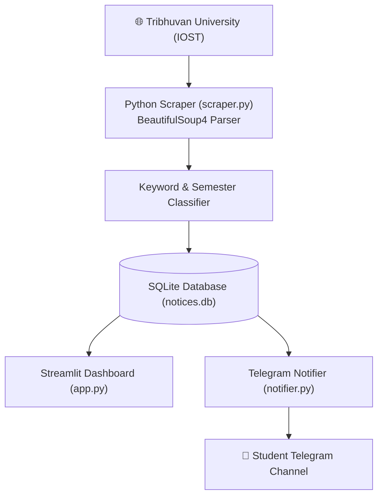

# 📢 TU CSIT Notice & Routine Alert Hub

An automated web scraping and notification pipeline engineered to monitor, categorize, and broadcast academic notices, exam routines, and results from **Tribhuvan University (Institute of Science and Technology)** for BSc CSIT students.

Developed by **[Samyog](https://github.com/hola-mundo999)** · *Backend Automation & Web Scraping*.

---

## 🌟 Key Features

1. **Automated Web Scraper:**
   - Periodically crawls official Tribhuvan University portals (`tuiost.edu.np`) using `BeautifulSoup4` and `requests`.
   - Categorizes notices into **Exam Routine**, **Results**, **Form Fill Up**, and **General Notice**.
   - Auto-detects applicable semesters (1st Sem through 8th Sem).
2. **Persistent Caching (SQLite):**
   - Deduplicates incoming notices using MD5 cryptographic hashing to prevent duplicate alerts.
3. **Telegram Channel Broadcaster:**
   - Formats instant Telegram Markdown notification payloads complete with urgent status badges and direct PDF view links.
4. **Modern Web Dashboard:**
   - Filter by semester, category, or keyword search.
   - Live metrics on total routines and results published.
   - One-click scraper sync trigger.

---

## 🏗️ System Architecture



---

## 🛠️ Tech Stack

- **Language:** Python 3.10+
- **Web Scraping:** BeautifulSoup4, Requests
- **Database:** SQLite3
- **Web Dashboard:** [Streamlit](https://streamlit.io/)
- **Version Control:** Git & GitHub

---

## 🚀 Getting Started

### 1. Clone the repository
```bash
git clone https://github.com/hola-mundo999/tu-csit-notice-hub.git
cd tu-csit-notice-hub
```

### 2. Set up virtual environment
```bash
python -m venv venv
venv\Scripts\activate   # Windows
```

### 3. Install dependencies
```bash
pip install -r requirements.txt
```

### 4. Run the dashboard
```bash
streamlit run app.py
```

Open `http://localhost:8501` to view the notice dashboard.

---

## 🌐 Deployment (Streamlit Community Cloud)

This is a Streamlit app. Deploy by connecting this repository to Streamlit Cloud
with entry point `app.py`. The scraper falls back to curated notices when the TU
portal is unreachable, and sync errors are shown on the dashboard.

---

## 🧪 Testing

```bash
pip install -r requirements.txt
pytest
```

The test suite (12 tests) covers SQLite deduplication (deterministic MD5 hashes,
not process-randomized `hash()`), notice filtering/search, scraper classification,
semester detection with word boundaries, and curated notice integrity.

---

## 📜 License
MIT License — Free to use, adapt, and build upon.
